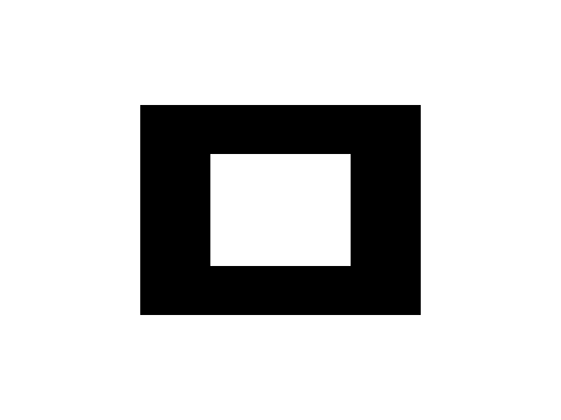
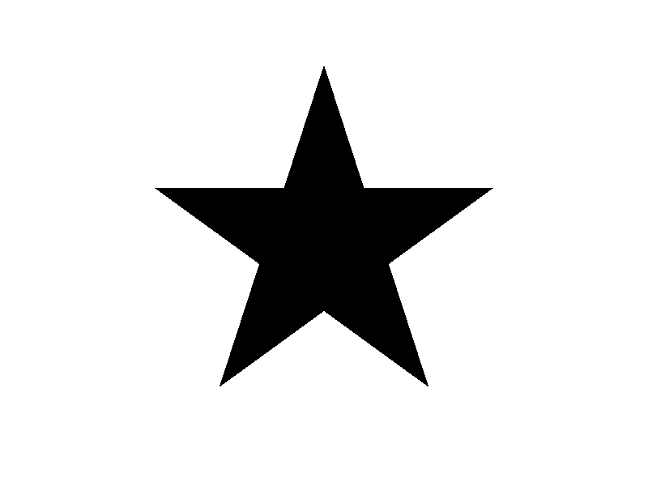
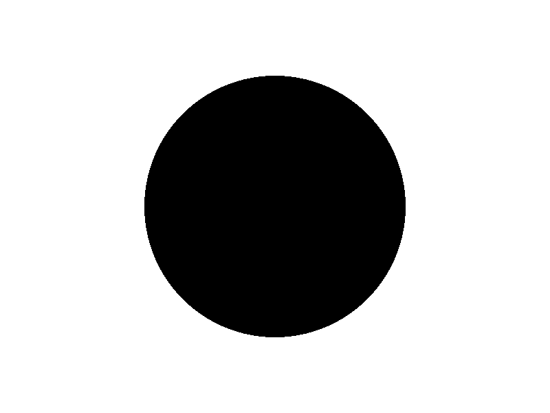

# Inside and Outside

**A Python laboratory for scanline rasterization, non-zero winding numbers, self-intersecting paths, and cubic Bézier contours.**

This repository explores how a geometric path becomes a raster image. It starts with direct pixel-array manipulation, builds a signed-crossing scanline rasterizer, and tests how path geometry and traversal direction affect the filled result.

The implementation calculates intersections, winding numbers, filled intervals, and Bézier approximations directly in Python. **NumPy stores the pixel array; Pillow only saves and previews the resulting image.** Neither package is used to decide whether a pixel belongs to a shape.

## Contents

1. [Features and experiments](#features-and-experiments)
2. [Requirements and installation](#requirements-and-installation)
3. [Run and reproduce](#run-and-reproduce)
4. [How the rasterizer works](#how-the-rasterizer-works)
5. [Experiment 0 — Direct pixel manipulation](#experiment-0--direct-pixel-manipulation)
6. [Experiment 1 — Rectangle and non-zero fill](#experiment-1--rectangle-and-non-zero-fill)
7. [Experiment 2 — Nested contours and direction](#experiment-2--nested-contours-and-direction)
8. [Experiment 3 — Self-intersecting pentagram](#experiment-3--self-intersecting-pentagram)
9. [Experiment 4 — Four-segment Bézier circle](#experiment-4--four-segment-bézier-circle)
10. [Experiment 5 — Concentric Bézier contours](#experiment-5--concentric-bézier-contours)
11. [Complete results](#complete-results)
12. [Source structure and implementation notes](#source-structure-and-implementation-notes)

## Features and experiments

| Capability | Implementation | Demonstration |
| --- | --- | --- |
| Direct RGB pixel control | NumPy `uint8` array | 401-pixel horizontal scanline |
| Scanline intersection detection | Edge/row intersection formula | Two crossings for a rectangle |
| Signed winding accumulation | Upward edge `-1`, downward edge `+1` | Inside/outside probes |
| Non-zero winding fill | Fill each interval whose running winding is non-zero | Solid rectangle |
| Multiple closed subpaths | Process and combine crossings from multiple contours | Nested rectangles |
| Self-intersecting geometry | One five-vertex path, skip-one visiting order | Solid-center pentagram |
| Cubic Bézier geometry | Four cubic segments per circle | Approximate circular contour |
| Recursive midpoint subdivision | Split at `t = 0.5`, then use subcurve endpoints | 256-vertex circular polygon |
| Direction-sensitive holes | Reverse only the inner contour's vertex order | Filled disk versus ring |

### Processing pipeline

```text
Path vertices / cubic Bézier control points
                |
                v
    Midpoint subdivision (for curves)
                |
                v
        Closed polygonal subpaths
                |
                v
  Scanline intersections + edge directions
                |
                v
       Running winding number
                |
                v
   Fill spans where winding != 0
                |
                v
       NumPy RGB pixel array
                |
                v
       Pillow PNG export / preview
```

## Requirements and installation

### Environment

| Item | Configuration |
| --- | --- |
| Reference platform | Windows desktop, PowerShell, VS Code |
| Reference Python | Python 3.10.8 |
| Python compatibility target | Python 3.10 or newer |
| Packages | `numpy`, `pillow` |
| Image format | 800 × 600 RGB, 8 bits per channel |
| Graphics device | No GPU required |
| Environment variables | None required |
| Optional tooling | VS Code with Python extension |

### Windows / PowerShell

Open PowerShell in the directory containing `main.py` and `bezier_geometry.py`.

```powershell
# 1. Create an isolated environment.
python -m venv .venv

# 2. Activate the environment.
.\.venv\Scripts\Activate.ps1

# 3. Install the dependencies.
python -m pip install numpy pillow

# 4. Execute the full experiment sequence.
python main.py
```

If PowerShell blocks activation, you can run the interpreter directly without changing execution policy:

```powershell
.\.venv\Scripts\python.exe -m pip install numpy pillow
.\.venv\Scripts\python.exe main.py
```

On macOS or Linux, create the environment with `python3 -m venv .venv`, activate it using `source .venv/bin/activate`, then install the same packages and run `python main.py`.

## Run and reproduce

Running `python main.py` executes the baseline tests in sequence. The application:

1. Creates a white RGB image and colors a single horizontal line.
2. Prints rectangle intersections and winding values at three test positions.
3. Fills a rectangle through the custom scanline renderer.
4. Renders two nested-rectangle orientation cases.
5. Renders one self-intersecting five-point star.
6. Builds and fills one circle represented by four cubic Bézier segments.
7. Renders two concentric-circle cases differing only in inner-contour traversal direction.

Every generated PNG is written **beside `main.py`**. Existing files with the same names are overwritten on a subsequent run.

`Image.show()` may open several image-preview windows using temporary names. This is normal: the actual output files retain the stable `experiment_*.png` names in the project folder. You may close previews after examining them.

## How the rasterizer works

### Coordinate system and pixels

The image is indexed as `canvas[y, x]`, with `x` increasing to the right and **`y` increasing downward**. For pixel indices `(x, y)`, geometry is evaluated at the pixel center `(x + 0.5, y + 0.5)`.

The fill color is black, `(0, 0, 0)`, on an initially white, `(255, 255, 255)`, background. This version uses **binary coverage** at the pixel center; it does not apply anti-aliasing.

### Finding intersections

For an edge from $(x_1, y_1)$ to $(x_2, y_2)$ and scanline $y_s$, the intersection position is:

$$
x_{\mathrm{hit}} = x_1 + \frac{(y_s-y_1)(x_2-x_1)}{y_2-y_1}.
$$

Implementation details:

- Horizontal edges are skipped.
- A non-horizontal edge contributes only when $\min(y_1,y_2) \le y_s < \max(y_1,y_2)$. This **half-open interval** avoids double-counting a shared vertex.
- Intersections from **all** closed subpaths are combined and sorted by their `x` positions.
- In this screen-coordinate convention, a downward edge contributes **`+1`** and an upward edge contributes **`-1`**.

### Running non-zero winding number

Moving from left to right across a scanline, each crossing changes the running sum. For the signed crossings $(x_i, d_i)$ at that row:

$$
W(x) = \sum_{x_i \le x} d_i, \qquad d_i \in \{-1,+1\}.
$$

The fill decision is:

$$
\mathrm{inside}(x,y) = \begin{cases}
\mathrm{true}, & W(x,y) \ne 0, \\
\mathrm{false}, & W(x,y) = 0.
\end{cases}
$$

The **sign itself is not an inside/outside flag**. Both negative and positive non-zero winding values correspond to filled regions. This is not the even-odd rule: crossings are *summed with direction*, not merely counted modulo two.

For consecutive crossings at $x_a$ and $x_b$, a non-zero running winding fills the pixels whose centers lie in $[x_a, x_b)$. The implementation converts these geometric positions into pixel slices with:

```python
x_start = max(0, math.ceil(x_a - 0.5))
x_end = min(width, math.ceil(x_b - 0.5))
canvas[y, x_start:x_end] = (0, 0, 0)
```

The renderer therefore processes **one scanline at a time**, without using a prebuilt polygon-fill function or repeatedly tracing a ray for every individual pixel.

## Experiment 0 — Direct pixel manipulation

**Objective.** Establish that RGB pixels can be written directly, with no drawing API responsible for coverage.

On an 800 × 600 white image, the program sets row `y = 300` and columns `x = 200` through `600` to black, inclusive.


**Measured result:** `401` black pixels. This is a pixel-array validation, not yet a closed-path fill.

## Experiment 1 — Rectangle and non-zero fill

**Objective.** Confirm correct scanline intersections, winding accumulation, and geometric area for a simple closed path.

The rectangle is defined in visiting order:

```python
rectangle = [
    (200, 150),
    (600, 150),
    (600, 450),
    (200, 450),
]
```

At scanline `y = 300.5`, the sorted crossings are:

| Intersection X | Crossing direction |
| ---: | ---: |
| 200.00 | -1 |
| 600.00 | +1 |

Testing three pixel centers on this scanline:

| Sample X | Winding number | Classification |
| ---: | ---: | --- |
| 150.5 | 0 | Outside |
| 400.5 | -1 | Inside |
| 650.5 | 0 | Outside |


**Measured result:** `120,000` filled pixels, matching the expected $400 \times 300 = 120{,}000$ pixel rectangle.

## Experiment 2 — Nested contours and direction

**Objective.** Validate support for more than one closed subpath and isolate the effect of contour direction.

The test combines an outer rectangle (400 × 300) and an inner rectangle (200 × 160), without changing their positions between cases.

| Case | Inner contour | Winding at center | Filled pixels |
| --- | --- | ---: | ---: |
| Same direction | Original traversal | -2 | 120,000 |
| Opposite direction | Reversed traversal | 0 | 88,000 |

| Same direction: both contours add | Opposite direction: center becomes a hole |
| --- | --- |
|  |  |

For the reversed inner contour, the unfilled region covers $200 \times 160 = 32{,}000$ pixels. The outer area minus this hole gives $120{,}000 - 32{,}000 = 88{,}000$ black pixels.

**Finding.** Two contours can have unchanged geometry yet give different rasterized results solely because their signed winding contributions add or cancel.

## Experiment 3 — Self-intersecting pentagram

**Objective.** Test a path whose interior cannot be described correctly by alternating filled and empty spans.

Five equally spaced outer vertices are calculated with sine and cosine, then visited in the order:

```text
0 -> 2 -> 4 -> 1 -> 3 -> 0
```

This is **one self-intersecting closed path**, not a ten-vertex polygon alternating between inner and outer corners.



| Measurement | Result |
| --- | ---: |
| Original outer vertices | 5 |
| Center winding number | -2 |
| Center classification | Inside |
| Filled pixels | 54,340 |

**Finding.** The center is filled because its signed winding number is `-2`, even though it is a region encircled multiple times. An even-odd fill would produce a different center result.

## Experiment 4 — Four-segment Bézier circle

**Objective.** Create a near-circular contour from cubic Bézier geometry and rasterize it using exactly the same polygon scanline implementation.

Each circle has four quarter-circle cubic segments. For each segment, the two direction handles follow the endpoint tangents and have length:

$$
h = 0.5523\,r.
$$

For angles $\theta_0$ and $\theta_1$ delimiting one quarter, the tangent direction is $(-\sin\theta,\cos\theta)$. The start/end points and the two handles define the cubic segment; the source builds all four segments in `create_bezier_circle()`.

### Midpoint subdivision and flattening

`split_bezier_half()` recursively splits each cubic at $t=0.5$ by midpoint interpolation. `midpoint_polyline()` replaces the resulting subcurves with the straight segments between their endpoints.

At subdivision depth $d=6$:

- Each cubic becomes $2^6 = 64$ line segments.
- Four cubics yield **256 polygon edges / 256 unique stored vertices**.
- The last vertex of each subdivided cubic is omitted when concatenating segments, because the renderer explicitly connects the last stored vertex back to the first.

This flattening method preserves the geometry and traversal order needed by the scanline renderer.


| Parameter or measurement | Result |
| --- | ---: |
| Center | (400, 300) |
| Radius | 190 px |
| Cubic Bézier segments | 4 |
| Subdivision depth | 6 |
| Polygon vertices | 256 |
| Center winding number | -1 |
| Filled pixels | 113,448 |

For context, the ideal continuous disk area is $\pi(190)^2 \approx 113{,}411.5$ square pixels. The rasterized total is not required to equal this value exactly: Bézier approximation and discrete pixel-center coverage introduce small differences.

## Experiment 5 — Concentric Bézier contours

**Objective.** Isolate the effect of traversal direction without altering geometry.

Two closed circles are constructed through the four-segment Bézier pipeline. Both use subdivision depth 6.

| Property | Outer contour | Inner contour |
| --- | ---: | ---: |
| Center | (400, 300) | (400, 300) |
| Radius | 190 px | 100 px |
| Cubic segments | 4 | 4 |
| Flattened vertices | 256 | 256 |

In the second case, **only the order of the already-computed inner polygon vertices changes**:

```python
same_direction = [outer_path, inner_path]
opposite_direction = [outer_path, inner_path[::-1]]
```

The coordinates and the set of points stay the same, and the outer contour is unchanged.

| Same direction | Opposite direction |
| --- | --- |
|  |  |

| Case | Winding at center | Center inside? | Filled pixels |
| --- | ---: | --- | ---: |
| Same direction | -2 | Yes | 113,448 |
| Opposite direction | 0 | No | 82,012 |

The reversed-contour case creates a hole containing `31,436` unfilled pixels relative to the fully filled disk, while keeping the outside boundary identical.

### Why this matters for the letter O

For a glyph rasterizer that uses the **non-zero winding rule**, a hollow glyph such as `O` can be represented by an outer closed contour and an inner closed contour with **opposite traversal directions**. Between the contours, the winding remains non-zero and the glyph is filled; inside the inner contour, the contributions cancel to zero and the counter (hole) remains empty.

If both contours wind in the same direction, their contributions reinforce one another and the intended hole can be filled incorrectly. This is a rule about contour winding under non-zero fill, not about moving the glyph's control points.

## Complete results

All values below were obtained by executing the provided implementations with the reference coordinates above.

| Output image | Center winding | Black pixels | Key observation |
| --- | ---: | ---: | --- |
| `experiment_0_scanline.png` | — | 401 | Direct pixel edit |
| `experiment_1_rectangle_fill.png` | -1 | 120,000 | Basic closed-path fill |
| `experiment_2_same_direction.png` | -2 | 120,000 | Matching contours add |
| `experiment_2_opposite_direction.png` | 0 | 88,000 | Reversed inner contour cancels |
| `experiment_3_pentagram.png` | -2 | 54,340 | Self-intersecting center remains filled |
| `experiment_4_bezier_circle.png` | -1 | 113,448 | Cubic Bézier to filled circle |
| `experiment_5_same_direction.png` | -2 | 113,448 | Two Bézier circles, matching direction |
| `experiment_5_opposite_direction.png` | 0 | 82,012 | Two Bézier circles, hollow center |

Note: the center winding values are measured at `(400.5, 300.5)` for the enclosed-shape experiments, using the sign convention defined above.

## Source structure and implementation notes

```text
Inside-and-Outside/
├── main.py                          # Scanline renderer and experiment runner
├── bezier_geometry.py               # Bézier construction and subdivision
├── README.md                        # Documentation and measured results
├── experiment_0_scanline.png
├── experiment_1_rectangle_fill.png
├── experiment_2_same_direction.png
├── experiment_2_opposite_direction.png
├── experiment_3_pentagram.png
├── experiment_4_bezier_circle.png
├── experiment_5_same_direction.png
└── experiment_5_opposite_direction.png
```

| Function | Role |
| --- | --- |
| `create_canvas()` | Allocate the white RGB raster image |
| `scanline_intersections()` | Compute sorted signed crossings on a scanline |
| `winding_number_at_x()` | Accumulate crossings up to a selected X position |
| `fill_nonzero_winding()` | Color intervals where the running winding is non-zero |
| `create_pentagram()` | Construct a five-vertex self-intersecting path |
| `midpoint()` | Interpolate between two control points |
| `split_bezier_half()` | Split a cubic Bézier segment into two cubics |
| `midpoint_polyline()` | Recursively flatten a cubic Bézier segment |
| `create_bezier_circle()` | Build four cubic segments forming an approximate circle |
| `flatten_bezier_circle()` | Join flattened cubics into a closed polygon path |

### Validation and implementation boundaries

- **Manual coverage:** All decisions about interior pixels come from the custom scanline winding code. The software does not call `polygon()`, `ellipse()`, built-in Bézier drawing, image fill, or built-in anti-aliasing operations.
- **Multiple contours:** Crossings from multiple closed subpaths are combined before computing the fill spans. Subpath order does not replace signed crossing direction.
- **Degenerate edges:** Horizontal edges are excluded, while half-open scanline intersections avoid duplicate vertex crossings.
- **Single-sample pixels:** Pixel-center binary coverage produces crisp but potentially stair-stepped boundaries. Supersampling and fractional coverage are not implemented here.
- **Reproducibility:** The PNGs are reference outputs of the fixed geometric inputs. Different inputs or sampling resolutions legitimately change the measured pixel totals.
- **Execution behavior:** The runner opens several preview windows; saved PNGs remain available independently of the preview windows.

### Further experiments

Potential extensions include multi-sample pixel coverage, scanline performance profiling, interactive contour editing, additional self-intersecting shapes, and visualization of individual winding intervals.

---

**Project principle:** Geometry defines the contour, contour direction determines the winding number, and the winding number determines which pixels are filled.
